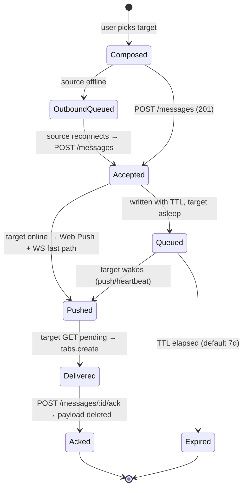
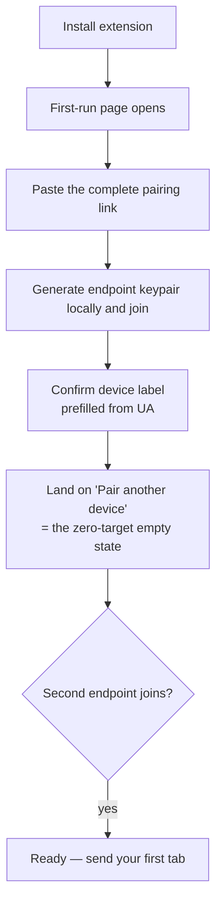
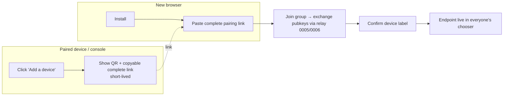

# Tabsend — Interaction & UX Flow Set

**Version:** 1.0
**Date:** 2026-07-16
**Status:** Draft for build (decisions logged as ADR-0008 in `DECISIONS.md`)
**Owner:** Ben (solo, vibe-coded)
**Relates to:** PRD §2, §4, §5, §5A, §6.1, §6.4; Decisions 0001–0007

---

## 0. Scope & how to read this

This spec turns the accepted architecture and UX decisions into concrete, buildable interaction flows for the three surfaces the owner called out:

1. **The send gesture** — what happens on every trigger surface, in every mode (§2).
2. **The chooser states** — multi-target, single-target auto-send, and offline/queued (§3), plus the zero-target empty state that precedes all of them.
3. **The pairing / onboarding flow** — first run, adding endpoints, phone, console (§6).

Everything here is downstream of the design principles (PRD §5A): the product should **disappear**, live in **native surfaces**, read as the **action not the brand**, and defer every trade-off to **"it always arrives."** Where a flow could go two ways, the tie is broken by whichever choice is quieter and more reliable.

Cross-references are written as `[0002]` (a Decision) or `PRD §6.1` (a PRD section). Nothing here contradicts an accepted decision; where this spec *chooses* among things a decision left open, it says so and the choice is captured in ADR-0008.

---

## 1. Foundations recap — the one shared model

Every surface is a thin trigger on top of a single pipeline. Building the pipeline once and mounting five triggers on it is the whole architecture of the client.

```
capture(payload) ──▶ resolveTargets() ──▶ pickTarget(surface, mode, state)
                                                      │
                                          ┌───────────┴───────────┐
                                     0 targets              1 target        ≥2 targets
                                          │                    │                  │
                                     onboarding           direct send       chooser / menu
                                          │                    │                  │
                                          └────────────▶  send(target, payload)  ◀┘
                                                              │
                                                    encrypt-per-target [0005]
                                                              │
                                                        feedback(result)
```

| Concept | Rule | Source |
|---|---|---|
| Addressable unit | Opaque per-profile endpoint; label `{browser} · {device}` | [0004] |
| Target list | One shared model feeds all surfaces (toolbar, menus, hotkey) | [0001] |
| Ordering | Pinned/primary → MRU recents → rest (alphabetical) | [0002] |
| Primary target | Per-source `primaryTargetId`, learned (MRU) with pin override | [0002] |
| Self | Excluded from its own target list | [0002] |
| Presence | **Non-gating** — offline targets are selectable; delivery queues | [0001], PRD §6.1 |
| Adaptive rule | Exactly one target ⇒ every surface sends direct, no chooser | [0001] |
| Encryption | E2E always on; title/favicon embedded in ciphertext | [0005] |
| Payload | `{ url, title, favicon }` — never just a URL (the "tab," not the link) | PRD §5A |

**Payload note (E2E):** because the sender already holds the tab's title and favicon, they travel *inside* the encrypted blob [0005]. The relay never sees them; the chooser and history render them client-side. This is why previews survive E2E.

---

## 2. The send gesture

### 2.1 The universal pipeline

`capture → resolve → pick → send → feedback`. Surfaces differ only in **capture** (what tab/link) and **pick** (chooser vs. direct). `send` and `feedback` are identical everywhere, which is what makes the gesture feel like one thing.

### 2.2 Toolbar icon — two modes, chosen by a setting  ⭐ decision

PRD §5A wants a **one-click quick-send**; [0001] wants the **icon to open the chooser**. These genuinely conflict: a browser action with a `default_popup` set *always* opens that popup and can never also fire a click handler. **Resolution: make it a setting, ship chooser as the default.** Both are right; one is the default, one is the opt-in power path.

| Setting | Left-click | Right-click on icon | Mechanism |
|---|---|---|---|
| **Chooser** (default) | Opens the rich styled popup chooser | Browser's extension menu + our "Options" | `action.setPopup({ popup: 'chooser.html' })` |
| **Quick-send** (opt-in) | Sends current tab to **primary**, shows toast | `Send tab to ▸ [targets]` + `Open chooser…` + `Options` via `contextMenus` `action` context | `action.setPopup({ popup: '' })` → click fires `action.onClicked` |

The toggle is graceful at runtime: flipping the setting calls `action.setPopup('')` or `action.setPopup('chooser.html')` — no reinstall, no manifest change. Default is **Chooser**, so out of the box [0001] holds verbatim; Quick-send is the §5A "the icon is the fast path" experience for power users who opt in.

**Guards in Quick-send mode:**
- **No primary yet** (fresh install, zero sends): click falls back to opening the chooser — you cannot quick-send to nothing. First pick establishes MRU/primary [0002].
- **Exactly one target:** click sends direct regardless of mode (adaptive rule).
- **Zero targets:** click opens onboarding ("Pair a device to send"), never a dead no-op.

### 2.3 Page & link context menus

Native, browser-rendered, plain by design [0001] — they *should* look native.

- **Page context menu:** `Send tab to ▸ [targets]` → sends the current tab's `{url,title,favicon}` on selection.
- **Link context menu:** `Send link to ▸ [targets]` → sends the right-clicked `info.linkUrl`. Title/favicon are best-effort here (a bare link has no tab metadata): title falls back to the link text, else the hostname; favicon best-effort from origin.
- **Collapsing:** with exactly **one** target the submenu flattens to a single item — `Send tab to Chrome · Work`. With **zero** targets the item reads `Tabsend: pair a device…` and opens onboarding.
- A shared menu builder rebuilds these items via `contextMenus.update/create/remove` whenever the target list or presence changes [0001]. Firefox may add a small per-item favicon/glyph as progressive enhancement; Chrome stays text-only (Chrome menus can't render icons).
- **Settings toggle** to hide the context-menu entries entirely, for users who want Tabsend fully out of the right-click menu [0001].

### 2.4 Firefox tab-strip context menu (Firefox only)

`Send tab to ▸ [targets]` on the **tab strip** (`menus` `tab` context, FF63+). This is the one surface where Firefox out-natives Chrome — Chrome has no `tab` context, so it simply doesn't exist there. Document as expected, don't fake it.

### 2.5 Keyboard shortcuts

- **Primary command** (default suggestion `Ctrl/Cmd+Shift+S`, user-rebindable): opens the **chooser** and honors "always choose." Because `chrome.action.openPopup()` is unreliable [0001], the implementation differs per browser:
  - **Chrome/Chromium:** open the chooser as a small **popup window** (`windows.create({ type:'popup', width:360, height:480 })` loading `chooser.html`). Trade-off: it shows briefly in the OS window list and steals focus. Accepted per [0001] option (b); upgrade to `action.openPopup()` later if Chrome makes it reliable under a user gesture.
  - **Firefox:** `browserAction.openPopup()` works from a user-input handler → open the **real** action popup. Nicer; use it.
- **Optional secondary command** — *"Send to primary"* blind-fire (no UI but the toast). Off by default; power users bind it. Fires to the same `primaryTargetId` the chooser shows on top, so "what's on top" always equals "what the hotkey hits" [0002]. Drift caveat from [0002] applies: unpinned MRU means the destination moves with recent sends — mitigation is to pin.

### 2.6 Android share sheet (send from mobile)

Out of scope for the desktop chooser decisions, covered here for completeness (full mobile UX is its own pass). Android registers as a **share-sheet target** plus per-endpoint **Sharing Shortcuts** (Direct Share) so `→ Firefox · MacBook Pro` can surface in the top row (PRD §5A). System ranks/caps Direct Share (~8 slots, no guaranteed placement); report shortcut-usage so frequent targets float up, allow manual pin. Share → target chosen from the sheet → same `send` pipeline. No rich chooser on mobile in v1; the sheet *is* the chooser.

### 2.7 Adaptive-rule matrix

What each surface does by target count (`n`), independent of platform:

| `n` | Toolbar (Chooser mode) | Toolbar (Quick-send) | Context menu | Hotkey (primary cmd) |
|---|---|---|---|---|
| **0** | Open onboarding | Open onboarding | Item → onboarding | Toast "No devices yet — pair one" + onboarding |
| **1** | One-row chooser → **explicit click** | **Direct send** + toast | Flat item → direct send | Same as the toolbar column |
| **≥2** | Open chooser | Quick-send to primary | Submenu of targets | Open chooser |

The "Hotkey" column is the primary command (`_execute_action`), which opens the action popup and therefore always mirrors the toolbar column, Chooser or Quick-send. The optional blind-fire `send-to-primary` (§2.5) sends direct at any `n`.

**`n=1` amendment (dogfood 2026-07-21).** The original rule suppressed the chooser entirely at `n=1` — even a toolbar click in Chooser mode sent directly, on the reasoning that a one-row chooser is friction, not choice. In real use that was wrong for the *toolbar* surface specifically: it made the "Open the chooser" setting look ignored (both toolbar modes behaved identically), flash-closed the popup before **Pair a device** / the pairing link could be reached, and sent the active tab off a bare icon click with no chance to back out. So the toolbar-triggered chooser popup (and its hotkey) now always opens and waits for an explicit click, even with one target. The rule is unchanged for the context menu — its single `Send tab to X` entry *is* already an explicit click — and for Quick-send mode's blind-fire, which is opt-in. See DOGFOOD.md 2026-07-21 and the amendment on [0001].

---

## 3. The chooser states

The "chooser" has one rich implementation (toolbar popup in Chooser mode; the hotkey popup/window) and one reduced implementation (the native context-menu submenu, which is just a flat target list). This section specs the rich chooser's states; the native submenu mirrors the same target list with no styling or status.

### 3.1 Anatomy of the rich chooser

```
┌────────────────────────────────┐
│  Send to…                   ⚙︎  │   header (⚙ = options)
│  [ 🔎 search… ]                 │   search: appears when targets > 7
├────────────────────────────────┤
│  ★ ▸ 🖥  Chrome · Work      ●   │   primary/pinned, online (● green)
│    ▸ 🦊  Firefox · Dev      ●   │   recent (MRU), online
│    ▸ 📱  Pixel · Phone      ○   │   offline (○ grey) — "last seen 2h"
│    ▸ 🖥  Edge · Laptop      ○   │
├────────────────────────────────┤
│  ⏳ 1 waiting for Pixel · Phone │   pending row — only when non-empty
└────────────────────────────────┘
```

- **Row:** device glyph + label + presence dot. Pinned/primary carries a ★. Offline rows show relative "last seen" on the row or hover.
- **Ordering:** pinned/primary → MRU recents → the rest alphabetical [0002].
- **Search:** input appears only when the list is long (> 7, configurable) to keep the common case chromeless.
- **Keyboard:** `↑/↓` move highlight, `Enter` sends to highlight, `Esc` closes, typing filters, `Tab` reaches search. **Primary is pre-highlighted** so `Enter` is an instant send — this is the Chooser-mode fast path.
- **Selection:** pick → row shows a check (~400 ms) → popup closes → in-page toast (§4).

### 3.2 State — zero targets (the empty state)

Not a chooser: an onboarding prompt. The product is inert with one endpoint (self is excluded), so this state's only job is to drive pairing.

> **You're the only device here.**
> Pair another browser or your phone to start sending tabs.
> **[ Pair a device ]**   Show QR / pairing link · or open the console

Every surface funnels here at `n=0` (§2.7). This is the most important empty state in the product — it is the on-ramp.

### 3.3 State — one target (one row, still a click)

The chooser renders normally with a single row: presence dot, label, and the persistent **+ New browser** pill in the header. Selecting the row is required — the popup does not send on open (§2.7 `n=1` amendment). The non-toolbar surfaces still send direct per [0001]: the context menu collapses to a flat `Send tab to X`, and Quick-send mode blind-fires from the icon.

### 3.4 State — multi-target (the default chooser)

The anatomy in §3.1. Pick a target → send → toast. No confirm dialog, no presence gate. Fast, quiet, keyboard-first.

### 3.5 State — offline / queued targets *inside* the chooser

Presence is **non-gating** [0001]: offline targets render with a grey dot and "last seen" but are fully selectable. Selecting one is a normal send; the difference is only in the resulting toast (§4) and the fact that the durable queue holds it until the target wakes (PRD §6.1). No warning, no "are you sure" — sending to an asleep browser is a supported, first-class action, not an error.

### 3.6 In-flight, sent, and error states

- **In-flight:** selection shows a check almost immediately and the popup closes — never block the UI on the network round-trip. The `send` is fire-and-confirm; the toast reports the outcome a beat later.
- **Sent (online):** toast "Sent to Chrome · Work" (§4).
- **Sent (queued):** toast reflects the offline target (§4, Q2 decision).
- **Source offline** (this browser can't reach the relay): the send is held in a **local outbound queue** and retried on reconnect; toast "No connection — will send when you're back online." (See the two-queue model, §5.)
- **Hard error** (relay rejects / endpoint unlinked): toast "Couldn't send — check Tabsend is still linked" → tapping opens the console/re-pair. Rare; distinct copy so it's diagnosable.

### 3.7 Multi-target send (P1)

PRD Should-have. The chooser gains a light multi-select affordance (a "Select multiple" toggle, or `⌘/Ctrl`-click to accumulate); picking several then **Send** fans out, encrypting **per target key** [0005]. Single-select stays the default and the fast path — multi-select is a mode you enter, never the thing in your way. Toast: "Sent to 3 devices" (or "Sent to 3 devices — 1 opens when it wakes" if any were offline).

### 3.8 Pending / queued surfacing — the Q2 decision

**Walk-through of the three options considered:**

- **(A) Quiet, honest note.** Same single toast as any send, but its *text* reflects target state: online → "Sent to Chrome · Work"; offline → "Sent to Chrome · Work — opens when it wakes." Costs nothing extra (the client already knows presence — it draws the dots), and it pre-empts the one moment a user could think it failed: sending to an asleep browser and not seeing it appear.
- **(B) Fully invisible.** Identical toast regardless of state. Maximally quiet, but risks the *silent-surprise* failure — the exact "did it even send?" feeling of flaky Send-Tab-to-Device that this product exists to beat. Trades away trust to save one clause of text.
- **(C) Distinct queued UI.** A standing "Queued" state + pending-items view in the popup. Most transparent, but a standing panel is "a dashboard to babysit" — against the invisible-utility principle — and it's real surface area to build and maintain.

**Recommendation (baked into this spec, trivially flipped):** **A, plus a restrained slice of C.** Use the honest toast for delivery feedback, and surface pending items **only inside the chooser and only when the queue is non-empty** — the slim `⏳ 1 waiting for Pixel · Phone` row in §3.1 that vanishes when it drains. This threads both principles: **invisible when nothing is pending, honest the instant something is.** No separate destination, no standing dashboard. If you'd rather go pure-A (drop even the conditional row) or pure-B, it's a one-line change — the toast copy and the optional row are independent switches.

---

## 4. Feedback & microcopy

Mis-send safety is **toast-only, no undo** (Q3 decision): every send confirms with a toast that **names the target**, so a wrong-target send is at least immediately visible; recovery is to send the right one and close the wrong tab by hand. No cancel window, no retraction message to build.

**Where the toast lives.** Quick-send and hotkey sends have no popup open, so the confirmation is an **in-page toast** injected by a content script (small, bottom corner, auto-dismiss ~2.5 s, no buttons). Honest limit: content scripts can't run on restricted pages (`chrome://`, the Web Store, the PDF viewer, some `file://`). **Fallback there:** a ~1 s **action-badge** check (`action.setBadgeText('✓')`) + title tooltip. Chooser-mode sends can show the in-popup check first, then the in-page toast.

**Copy table (exact strings):**

| Outcome | Toast |
|---|---|
| Sent, target online | `Sent to Chrome · Work` |
| Sent, target offline/asleep | `Sent to Chrome · Work — opens when it wakes` |
| Quick-send to primary | `Sent to Chrome · Work` *(primary; no extra chrome)* |
| Multi-target, all online | `Sent to 3 devices` |
| Multi-target, some offline | `Sent to 3 devices — 1 opens when it wakes` |
| Source offline (outbound queued) | `No connection — will send when you're back online` |
| No devices yet (blind-fire/hotkey) | `No devices yet — pair one to start sending` → opens onboarding |
| Hard error (unlinked/rejected) | `Couldn't send — check Tabsend is still linked` → opens console |

Tone: lowercase-verb, device-named, no exclamation, no brand word. The toast reads as the action, not the app (PRD §5A). A settings toggle can silence success toasts for users who want zero feedback (error toasts still show).

### 4a. Amendment — the feedback banner (dogfood 2026-07-29)

The toast above could only say nice things, and quick-send said them *before* the send. Sending from Firefox to Arc stopped working when the relay moved to a self-hosted mini PC, and no surface anywhere said so: the confirmation appeared as usual, the tab never arrived, and the tabs piled up invisibly in the outbound queue. Three changes, all narrowing what the UI is allowed to claim.

**1. "Sent" is now a claim about the relay, not about the click.** A send has three outcomes, not two:

| Tone | Means | Headline |
|---|---|---|
| ✓ success | the relay **accepted** it | `Sent to <label>` (+ `Opens when it wakes` if the target is asleep) |
| ↑ pending | held locally; nobody has it yet | `Waiting to send to <label>` / `Sending to <label>` during the undo window |
| ! error | it will not happen without you | `Couldn't send to <label>` |

A tab held in the source-side outbound queue is `ok` (it isn't lost) but **not** `Sent` — it gets the pending tone. `SendResult.failure` is the machine-readable version of that distinction; its absence is the only proof a surface has that "Sent" is true.

**2. Every failure gets a sentence a person would say out loud.** `No connection` was a wrong diagnosis for the common self-host failure — the browser's network is fine, the relay is down — and it sent the user to check their wifi. Worse, a relay refusal used to pass the wire code straight through (`Your relay refused the send: Unknown target.`). **No user-facing line may contain a wire code**, and the target's name is threaded into the copy so the sentence is about a device, not an identifier:

| Cause | Line |
|---|---|
| Browser really offline (`navigator.onLine === false`) | `You're offline — this tab sends itself as soon as you're back.` |
| Network up, relay never answered | `Can't reach your relay at <url>. The tab is held here and sends itself once the relay answers again.` |
| `unknown_target` | `Your relay doesn't know <device> any more. Pair it again, then send this tab a second time.` |
| `expired_key` | `The keys on <device> have changed since this browser last saw them. Open the Tabsend list once to pick up the new ones, then send again.` |
| `not_in_group` | `Your relay says <device> has left your group of devices.` |
| `invalid_request` | `Your relay didn't understand this send. It's most likely running an older version than this browser — updating it should fix this.` |
| `internal` (and any unrecognised code) | `Something went wrong inside your relay. It may be worth checking that it is healthy.` |
| Relay rejects our token | `Your relay doesn't recognise this browser any more. Set Tabsend up again here to start sending.` |

**`not_in_group` is no longer emitted, since ADR-0029 (annotated 2026-08-20).** A target
outside the caller's group now answers `unknown_target` — same reason, same shape, same
bytes — because on a shared relay the distinction was an endpoint-existence oracle. The
row stays because an older relay still sends the code and the literal stays in the wire
union, so every client keeps its copy; nobody should tidy either away.

Two copy rules fall out of this and are enforced by tests: the device label appears **mid-sentence only** (the no-label fallback "that device" is not a proper noun and would open a sentence in lowercase), and `ApiError.message` — which the contract says MAY change, and which is written for a log — never reaches a surface. Only the code travels; the client owns the wording.

**3. The banner names the tab and sits under the toolbar icon.** Top-right (not the bottom corner), shadow-isolated. The tab is shown as an **identity row** — favicon + page title — deliberately styled unlike the status line beneath it, which is separated by a hairline. Styled the same, a title like "Setting up a LAN relay" reads as part of the explanation rather than as the name of the thing being moved. Dwell: success ~2 s, pending ~4 s, error ~9 s with a Dismiss. Same restricted-page limit and same action-badge fallback as before; the badge is always set, so a failure never depends on the injection succeeding.

**Follow-up, not just feedback.** Quick-send's optimistic banner is replaced by the real outcome when the held send dispatches (routed back to the originating tab). When the relay recovers and the queue drains, the sends that had actually failed are announced, naming the tab when there was only one. And a standing outage — 30 s of silence, so a container restart doesn't cry wolf — is shown as a strip in the chooser and on the options page next to the relay address.

### 4b. Amendment — the "waiting on this browser" list

`⏳ N waiting for <device>` counts messages **the relay already has** and is holding for a sleeping target. During an outage that row is not merely wrong, it is *empty*: its source is the relay's own outbox, which is unreachable exactly when tabs start piling up. So the state with the most tabs at risk had the least visible evidence — a count of zero and no way to find out which tabs were stuck.

The chooser gains a second, separate section listing the tabs **still on this browser**, newest first, each named and showing its destination. Keeping it distinct from the ⏳ row is the point: "the relay has it" and "we still have it" are different promises, and merging them would let an outage read as a normal sleeping device.

To name a held tab, the outbound queue stores its title and URL in **plaintext, device-locally**, alongside the envelope. The envelope is sealed to the target's key, so a queue of envelopes can be counted but never described. This adds nothing to the wire — the relay still only ever sees ciphertext — and the entry is deleted with the item when it drains. The tab it describes is open on the same machine anyway. Console history copies are flagged and never appear in the list or the counts.

### 4c. Mobile surfaces (2026-07-29)

§4a–4b apply verbatim to iOS and Android; only the *where* differs, because the sending UI is ephemeral on both. `ShareActivity` toasts then `finish()`es and `ShareViewController` completes its request and is torn down, so there is no badge and a delayed outcome has nowhere to land.

| Extension | Android | iOS |
|---|---|---|
| in-page banner | local notification | local notification |
| dwell ~2 s (success) | `setTimeoutAfter(2000)` | **no equivalent** — success is not notified at all |
| error lingers + Dismiss | no timeout, `setAutoCancel(true)` | stays until swiped |
| `showSuccessToast` setting | two channels: `send_status` (LOW), `send_problems` (HIGH) | one flag, off by default |
| toolbar badge fallback | the in-app waiting list | the in-app waiting list |
| chooser held-tabs list | a section on the home screen | a section in `PairedView` |
| chooser relay-outage strip | in-app banner above the list | in-app banner above the list |

One notification id per send, derived from the message id. Deliberately NOT the extension's single-element behaviour: two concurrent sends must not clobber each other's outcome, so the id is reused only to replace a send's *own* earlier state. (§4d then splits that id space by kind, so a pending notice can be withdrawn without touching a settled one.)

The outage line and the held list are two separate blocks, not one. "The relay is down" and "we are still holding these tabs" are different facts: the outage line is gated behind the 30 s grace, while the list shows whenever there is anything in it — a phone that was in a tunnel is not an outage, but the tabs are waiting all the same. Merging them lets one hide the other.

The device label reads "this phone" rather than "this browser", and `expired_key`'s "Open the Tabsend list once" becomes "Open Tabsend once" — the only clause that changes. Diagnosis and suggested action are identical across all three clients, enforced by a test per platform that walks every member of both closed wire sets.

### 4d. Amendment — a pending notice is a promise, and promises are withdrawn (2026-08-16)

A pending notification is not a report. It says the relay is unreachable *right now* and the tab will go by itself when that changes — a claim about the present that keeps being made for as long as the notice is on screen. Nothing was ever withdrawing it. The relay came back, the queue drained, a "Sent the tab that was waiting" notice appeared and cleared itself, and the original `Waiting to send to <label>` stayed in the shade indefinitely, still naming an outage that had ended (dogfood 2026-08-16). On iOS it was worse, because nothing there self-dismisses at all.

Three rules follow, and they apply to Android and iOS. The extension is exempt because it has no persistent surface to correct: its pending signal is an in-page banner with a ~4 s dwell and a ~2.5 s badge flash, and its held-tabs list and outage strip are re-read from storage every time the chooser opens.

1. **The queue is the truth, and the notice is reconciled against it.** Whatever just happened to the outbound queue — drained, refused, wiped by an unpair — the pending notices that survive are exactly those whose message is still in it. Not "cancel the ids this flush settled": most notices were posted by a share sheet that is long dead, and the process doing the reconciling has no memory of what was ever announced. This also cleans up after a process death mid-outage.

2. **A standing promise is filed apart from a settled verdict**, so a sweep can tell them apart: Android tags (`send.pending` / `send.outcome` / `send.flush`) rather than an offset id range; iOS identifier prefixes. A settled outcome is the only record that something finished and is never swept — which on iOS is exactly why it stays until it is swiped.

3. **A reconnected socket flushes the outbound queue**, not just the inbox. The WS coming up is the earliest and most certain evidence that the relay is answering; spending it only on the receive side left held tabs waiting out the ~5-minute poll tick (up to ~15 in Doze) or, on iOS, a foreground drain that might never come. The notice outliving the outage by minutes was the visible half of that.

Reconciliation runs from the flush path (poll chain, heartbeat, socket reconnect, background refresh) *and* from the home screen, since opening the app is when a stale notice is most obviously wrong and nothing guarantees a background pass ran first.

### 4e. Amendment — the extension shares the recoverable/final split (2026-08-16)

§4a's failure table lists what a relay says when it says *no*. It has no row for a relay that says *not now*, and the extension had no notion of one: every non-2xx was a permanent refusal. So a 429, or the HTML 502 a reverse proxy serves for the few seconds a relay container takes to restart — which carries no error envelope, and is therefore indistinguishable from `internal` — read as a dead end. On a first send that lost the tab; on one pass of the outbound queue drain it discarded **everything the queue was holding**, silently, after the user had been told those tabs were waiting and had walked away. Android and iOS had this fixed on 2026-07-29 (ADR-0008, "a held tab reports either way"); the extension had not.

Two rules, now the same in all three clients:

1. **A 429 or any 5xx is "not now", classified on the STATUS rather than the code**, and the tab stays in the outbound queue. It joins browser-offline and relay-unreachable as a *recoverable* failure — pending tone, no user action implied: `Your relay is having trouble right now. The tab is held here and sends itself once the relay is answering properly again.` (Android and iOS say "the tab", same sentence; the §4c device-noun rule does not bite here because the line names no device.) An item leaves the queue only on a definite answer: accepted, or refused in a way retrying cannot change.

2. **A held tab that is finally refused says so.** The queue draining already announced itself; the other half was silence, which was the original invisible-failure bug with a longer fuse — the promise was made, the relay came back, and the answer was no. It is announced in error tone (`Couldn't send “<title>”` / `Couldn't send N tabs that were waiting`) with the §4a diagnosis beneath it, naming the device from the endpoint cache. Never gated behind the success-toast setting, which silences confirmations and not this.

Consequence, closed by §4f below: a relay that permanently 5xxes one particular envelope used to be retried forever, because the queue had no age cap. Keeping the tab is still right; what was missing was anything that ever ended the wait.

### 4f. Amendment — a wait ends, and the person waiting can end it (2026-08-18)

§4e settled what releases a held tab: a definite answer from the relay, and nothing else. That half is correct and unchanged here. The half it left open is that **nothing ever ended a wait**, so the queue had no ceiling in either direction — an envelope one relay permanently 5xxes was retried on every drain, every heartbeat and every reconnect for as long as the profile or the install lived; sharing through a long outage grew the queue without bound; and the waiting list was read-only on all three clients, so a tab aimed at a relay that was never coming back could only be watched.

Four rules, the same in the extension, Android and iOS.

1. **A tab that has waited longer than the relay's own message TTL is given up on.** Seven days, pinned to `DEFAULT_MESSAGE_TTL_DAYS` in `shared/src/types.ts` rather than chosen, so client and relay hold ONE opinion about when a send is dead: past that horizon the relay would have deleted the message anyway. The extension imports the constant; Kotlin and Swift hand-mirror it with a comment naming the source, exactly as the copy tables do. Age is measured from when the user hit send, never from the last retry — a queue that restamped its items on every failed drain would expire nothing at all. Deliberately an age cap and **not** a consecutive-5xx counter: a counter converts a run of "not now" into a hard failure, which is precisely the verdict §4e exists to prevent, and it would empty the queue during exactly the long proxy outage the split protects. Age has no false-kill mode, and it ends the poison envelope anyway, because that ages out like everything else.

2. **The queue holds at most 200 tabs, and over the cap the OLDEST go.** Age alone does not bound a burst: one multi-tab send is N items in a single click, and a week is a long time to keep clicking. The newest item is the one the user just asked for, so evicting it would be the single worst choice available. Not free either: on Android and iOS the whole queue is one blob rewritten on every change (SharedPreferences / App Group UserDefaults), so its length is paid for on every send rather than only when something reads it. Console history copies [ADR-0010] are not counted — they are not tabs anybody sent — and they never appear in a user-facing count, which is the rule §4b already set.

3. **Both are announced, never silent.** That is the whole lesson of §4d and §4e: a promise was made ("the tab is held here and sends itself once the relay answers again") and this is the moment it stops being kept. It reuses the existing dropped announcement, in error tone, so a person who walked away from the share sheet a week ago is told the same way they would be told about a refusal. One new client-side `SendFailure` kind carries it, with two reasons because the sentences differ and one line for both would be false half the time: `This tab waited 7 days for your relay and was never taken, so Tabsend has stopped holding it. Send it again once the relay is answering.` and `Tabsend holds at most 200 tabs while your relay isn't taking them, and this one was the oldest. Send it again once the relay is answering.` Neither names a device, so the §4c device-noun rule does not bite and all three clients say them verbatim. It is a **classification, not a wire code** — the one failure the client decides by itself — so the closed wire sets in `shared/src/types.ts` are unchanged, and each platform's exhaustive copy test grew a member instead.

4. **The waiting list can let go of a tab.** A × on the chooser row, a "Stop waiting" button on the Android home screen, swipe-to-delete on the iOS list. A pure local delete: nothing is transmitted, because there is nothing to retract — the same principle as the quick-send undo window. Worded "stop waiting" rather than "cancel" because it cannot unsend: an item whose POST is in flight at that instant may still be accepted and delivered, and a tab the relay has already taken is beyond any of this. No announcement — §4d is about withdrawing a promise the user has not been watching, and this is the user doing it themselves. Cancelling a real tab takes its console history copies with it, or the console would grow a history row for a send that never happened.

The rule itself lives in one pure function per client (`extension/src/lib/outbound.ts`, `logic/OutboundQueue.kt`, `TabsendKit/OutboundQueue.swift`), following `SendNotices` from §4d. It runs at both ends — when something is enqueued, and at the top of every drain — and the drain is the half that matters for the poison envelope, which is never competing with newer sends for the size cap and so can only ever be ended by its own age.

One deliberate gap, recorded because the code alone reads as a null check. Tying a copy to its send needed a new device-local field, so a copy written by an older build cannot name its parent, and rule 4 therefore cannot tell whether that parent has just left. It keeps such a copy rather than guessing — erring, unusually for this section, towards the false row instead of away from it. The exposure is one narrow case: a queue that straddles the upgrade, on a profile with a console paired, whose owner then abandons a held tab. Expiry cannot reach it, since a copy carries its send's own timestamp and both age out in the same sweep, and eviction needs 200 real tabs; and it closes by itself once every pre-upgrade item has aged out. Dropping those copies outright would also have been defensible — ADR-0010 accepts history *gaps* and accepts no false rows at all — but it would discard every legitimate pending copy belonging to anyone mid-outage when the upgrade lands, in order to prevent a row describing a send the user really did make and then retracted. Certain loss to avert an unlikely wrong record is the worse trade.

---

## 5. Delivery & queue state machine (why a send can't be "lost")

Two independent queues guarantee "it always arrives," each covering a different outage:

- **Outbound queue (source-side):** if *this* browser can't reach the relay, the send is persisted locally and retried on reconnect. Covers *source* offline.
- **Durable queue (server-side, PRD §6.1):** every accepted send is written with a TTL *before* any delivery attempt, then the target is woken by Web Push [0006]; the target pulls, delivers, and acks; the server deletes on ack. Covers *target* offline/asleep. Idempotent by message ID → re-wakes and reconnects never double-open a tab.



The UI only ever surfaces two of these to the user: the **toast** at Accepted/Queued (§4) and the optional **`⏳ waiting` row** while a message sits in Queued (§3.8). Everything else is invisible plumbing.

---

## 6. Pairing & onboarding

Grounded in the account-less device-group model [0003]: the relay creates its group and every endpoint joins with a **complete pairing link**, either scanned as a QR or pasted. No email or password to use Tabsend. Pairing is a **first-class onboarding surface and must be dead simple** [0003, 0023, 0024].

### 6.1 First run — joining the relay's group



Notes:
- **Label capture** [0004]: the extension first asks for a browser name, then asks for the device name after the link is accepted; Android asks for the device name beside the pairing link. No hostname/profile auto-detection (privacy).
- **The relay owns its group** [0023]: setting up the relay IS setting up the group — there is no separate create step on any client. A relay with no devices yet prints a pairing link in its startup log; that link is how the FIRST device gets in, whether it's a phone or a browser. Once anyone has joined, the link stops appearing and pairing is device-to-device as normal.
- **One group per relay** [0022]: the default relay creates its group itself; clients never choose or mention groups during onboarding. Multi-group remains an explicit server option, not a normal client workflow.
- **Links are indivisible credentials** [0024]: the URL carries the relay address, one-time secret, and optional self-signed TLS fingerprint. Clients reject a detached short secret because it cannot identify or trust the relay.
- **No recovery key** [0021]: group creation mints no phrase and there is no nudge to skip. Losing every device = losing the group, deliberately — a device-less group has only dead endpoints and history sealed to keys that no longer exist, so there is nothing a restore could hand back. The user preserves the old state, starts the relay with a new empty database, and pairs into the fresh group.
- The first run *ends* on the empty state (§3.2) by design — with one endpoint there is nothing to send to, so "pair another" is the only forward motion.

### 6.2 Adding an endpoint — desktop → group

The device **already in the group** mints the link (it holds group authority); the **joining** device consumes it.



- **QR vs paste:** camera-capable clients scan the QR; other clients copy and paste the complete link. Both carry the exact same link.
- **Canonical entry point:** the **console** "Add a device" screen (always available). **Convenience entry point:** any paired extension exposes "Pair another device" in its popup/Options, showing the same QR and link.
- **Pubkey exchange:** on join, the new endpoint publishes its public key to the group via the relay; senders fetch target pubkeys, trust rooted in the pairing step [0005].

### 6.3 Adding the phone (Android)

Install app → paste a complete pairing link or **scan the QR** shown by the console or a paired extension → confirm the device name → join. The scanner preserves the full link, including any self-signed TLS trust pin [0019, 0024]. From then on the phone is both a send source (share sheet, §2.6) and a receive target (notification → open in the default browser, PRD §6.4).

### 6.4 Authorizing the web console

The console is not a login; it is authorized by a complete pairing link created by a paired device [0003, 0024]. It extracts the relay address and one-time secret locally, then becomes a `kind:'console'` endpoint that can decrypt its own E2E history copies [0005].

### 6.5 Pairing edge cases & light security awareness

| Case | Behavior |
|---|---|
| Code expired | Clear message + one-tap regenerate. Codes are short-lived by design. |
| Code already consumed | One-time use; second attempt errors ("that code was already used"). |
| Network drop mid-pair | Resumable; the endpoint is **not** added until pubkey exchange confirms — no half-joined ghosts. |
| Reinstall / re-pair | Creates a **new** endpoint; the stale one goes offline and is pruned by last-seen [0004]. The new key is new on a phone or after a reinstall, **not** after a re-pair of the extension, which keeps its device key (corrected 2026-10-13; `PLANS.md` P-14 item 8 depends on it). |
| New device joined | Existing devices show a non-blocking alert and a banner: "New device: Firefox · Linux. Joined just now. Was this you?", with "Yes, it's mine" and "Remove it". Awareness, not a gate. Built 2026-10-08; the rule and copy are in `PLANS.md` P-10. |
| First list a device sees | A one-time card, "Check your devices", lists the other devices with a Remove each and "All of these are mine". It stays until answered. On upgrade, the list the previous build kept is the starting point, so a device added since gets the alert above. Built 2026-10-13 (`PLANS.md` P-14 item 1). |
| A new device appears, then disappears | The banner is replaced by "{label} joined, then disappeared" until dismissed, on every device that announced it and did not answer it, except one that removed it itself. Built 2026-10-13 (`PLANS.md` P-14 item 2). |

### 6.6 The first-send moment (establishing primary)

After the second endpoint joins, nudge once: **"Send your first tab."** On first run there is no primary yet, so the chooser lists all targets alphabetically until the **first send establishes MRU** [0002]. After that, the primary floats to the top and the fast paths (Quick-send, blind-fire hotkey) light up. No separate "set your primary" step — it's learned, with pin available in the chooser for anyone who wants to lock it.

---

## 7. Settings surface (what's configurable)

- **Toolbar click mode:** Chooser (default) / Quick-send (§2.2).
- **Hotkeys:** rebind the primary "open chooser" command; optionally enable + bind "Send to primary" blind-fire.
- **Context-menu entries:** show/hide the page & link menu items [0001].
- **Success toasts:** on (default) / off (error toasts always show).
- **Pending row in chooser:** on (default) / off (the §3.8 conditional row).
- **Primary target:** view/change/pin per this source [0002]. **E2E is not a setting** — it's always on [0005].
- **Devices:** rename, remove, see online/last-seen; "Add a device" (§6.2).

Defaults are chosen so a user who never opens settings gets the quiet, [0001]-faithful experience; every power-user affordance is opt-in.

## 8. Accessibility

Keyboard-first chooser (§3.1): full arrow/Enter/Esc/type-to-filter operation, visible focus ring, primary pre-focused. Rows are buttons with accessible names (`"Send to Chrome · Work, online"` / `"…, offline, last seen 2 hours ago"`) so screen readers announce target **and** status. Presence dots are never the *only* signal — status is in the accessible name and (on offline rows) the visible "last seen" text, so color-blind and SR users lose nothing. Toasts use a polite live region; the badge fallback sets a descriptive title. Target contrast: WCAG AA for text and the dot against both light and dark toolbars (the toolbar glyph already ships as `currentColor` monochrome, PRD §5A).

## 9. Edge-case & failure matrix

| Situation | What the user experiences |
|---|---|
| Send to offline target | Normal pick; toast "…— opens when it wakes"; delivered on wake within TTL (§5). |
| Source browser offline | Toast "No connection — will send when you're back online"; auto-retried (§5). |
| Restricted page (`chrome://`, Web Store, PDF) | Send still works; confirmation degrades to badge ✓ instead of in-page toast (§4). |
| Duplicate/re-send same link | Idempotent by message ID [PRD §6.1] — no double tab. |
| Target reinstalled (stale endpoint) | Old endpoint shows offline, then is pruned by last-seen [0004]; send to the new one. |
| Only one endpoint total | Toolbar/hotkey open a one-row chooser needing an explicit click; context menu and Quick-send still send direct (§2.7, `n=1`). |
| Zero endpoints | Every surface routes to onboarding, never a silent no-op (§3.2). |
| Link menu on a bare URL | Sends the link; title falls back to link text/hostname, favicon best-effort (§2.3). |

## 10. Open items / hand-off to `shared/` contracts

These flows imply the following, to be locked in the `shared/` types pass (the next decision-queue item):

- **Endpoint:** `primaryTargetId?`, `primaryPinned: boolean`, `lastSeenAt`, `status`, `label`, `browser`, `platform`, `pubkey` — already largely in PRD §6.3; confirm `primaryTargetId`/`primaryPinned` live per-endpoint (per-source) [0002].
- **Client-local settings (not synced):** `toolbarClickMode: 'chooser' | 'quicksend'`, `showSuccessToast: boolean`, `showPendingRow: boolean`, `contextMenusVisible: boolean`, hotkey bindings.
- **Message:** carries the fields the toast needs *before* delivery is known — the client derives "queued vs. sent" from target presence at send time, not from a server round-trip, so the toast is instant.
- **Pairing:** `pairing_codes` already in PRD §6.3; confirm code length (6–8 chars) and TTL, and that QR encodes the same code.
- **MRU storage:** device-local recents [0009]; the chooser ordering reads from local storage (relay never stores primary/pin/MRU).

**Unresolved-but-flagged UX choices** (defaults chosen here, easy to flip): pending-row on/off (§3.8), success-toast default on/off, exact "long list" search threshold (§3.1), and ~~whether the "new device joined" notice (§6.5) ships in v1 or P1~~ (built 2026-10-08, `PLANS.md` P-10).

---

*End of Interaction & UX Flow Set v1.0. Decisions locked here are recorded as ADR-0008 in `DECISIONS.md`.*
